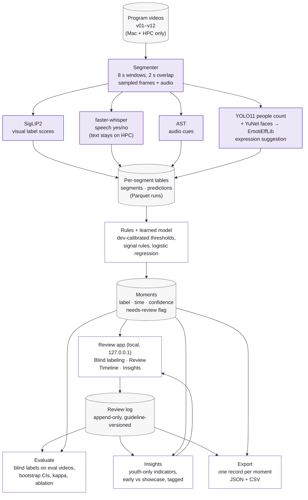

# Architecture: TPA Video Index

## Legend

| Colour | Where it runs |
|---|---|
| Purple fill | **Heavy processing on UNF HPC** (one GPU per job): segmenting, SigLIP2, faster-whisper large-v3, AST, YOLO11m, YuNet + EmotiEffLib. The same stages also run on the Mac with smaller models (SigLIP2 base, faster-whisper small, YOLO11n), which the Mac benchmark measures. |
| White fill | **On the Mac** (or any machine TPA owns): rules and moments, the review app, evaluation, insights and the export. No GPU needed. |
| Grey fill | **Stored data.** |

## Where data lives

- **Videos**: in a data folder on the Mac and in UNF HPC private folders, outside the repo. Never in git or the cloud.
- **Per-segment tables and moments**: one immutable Parquet folder per run, in an outputs folder outside the repo. Runs are synced from HPC to the Mac as Parquet only. A config file lists which runs count as official.
- **Transcripts**: only on HPC, inside the transcript run folder. Never synced, shown or exported.
- **Review log**: a local database on the Mac. It is append-only, and every row carries reviewer, time and guideline version.
- **Results and exports**: evaluation and insights results, annotation exports and benchmark summaries go to the outputs folder on the Mac. Only aggregates are written, with no filenames, transcript text or per-person fields.
- **In the repo**: code, configs (labels, pipeline settings, theme), mock data tools and the mock-only Devpost sample. Never footage, filenames or real metadata.
