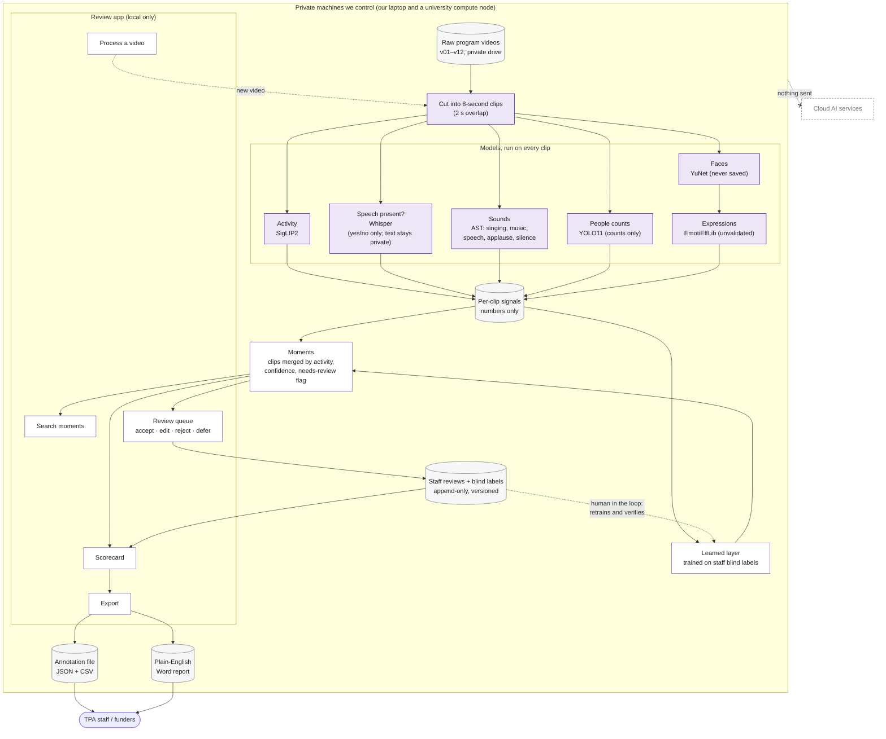

# Architecture: TPA Video Index

From raw video to the people who use the results. Everything runs inside one privacy boundary.

## Walk-through

- **Raw program videos**: TPA's footage sits on a private drive and is referred to only as v01–v12.
- **Cut into 8-second clips**: each video is split into short overlapping clips, the unit everything else works on.
- **Activity (SigLIP2)**: scores each clip against TPA's label list (for example singing, dance, acting).
- **Speech present? (Whisper)**: records only whether someone is speaking. The words themselves stay private and are never shown or exported.
- **Sounds (AST)**: detects singing, music, speech, applause and silence.
- **People counts (YOLO11)**: counts how many people are visible. It never tracks or matches a person.
- **Faces (YuNet) → Expressions (EmotiEffLib)**: finds faces only to suggest a visible expression, such as a smile. Faces are handled in memory and never saved, and expressions are always marked "unvalidated".
- **Per-clip signals**: the numbers from every model, one row per clip, with no images.
- **Learned layer**: a small model trained on staff's blind labels that combines the signals into better activity, category and youth-vs-staff labels.
- **Moments**: neighbouring clips with the same activity are merged into moments with a confidence score and a "needs review" flag.
- **Process a video**: staff run the same pipeline on a new video from the app.
- **Search moments**: find moments by activity, video or review status.
- **Review queue**: staff accept, edit, reject or defer each AI label.
- **Staff reviews + blind labels**: every decision is saved as a new row, never overwritten. These rows feed back into the learned layer and decide which numbers count as staff-verified.
- **Scorecard**: youth-only program indicators per video and phase, each tagged staff-verified, model estimate or mixed.
- **Export**: writes the official annotation file and the Word report.
- **Annotation file (JSON + CSV)**: one record per moment, with its source and review decision.
- **Plain-English Word report**: the scorecard in words, for people who don't use the app.
- **TPA staff / funders**: receive aggregate, program-level results only. Nothing about individual youth.
- **Cloud AI services**: not used. No footage, signal or result is sent outside the boundary.

## Legend

| Colour | Meaning |
|---|---|
| Purple fill | **Models.** Full-size models on a university compute node (GPU) for the full run: SigLIP2 so400m, Whisper large-v3, AST, YOLO11m, YuNet + EmotiEffLib. Smaller versions of the same models run on our laptop (SigLIP2 base, Whisper small, AST, YOLO11n, YuNet + EmotiEffLib), with the same pipeline and commands. |
| White fill | **Rules, learned layer and the app.** These run on the laptop (or any machine TPA owns). No GPU needed. |
| Grey fill | **Stored data.** |
| Dashed outline | **Not used.** Shown to make the boundary explicit. |

## Where data lives

- **Videos**: on a private external drive and in a private university compute folder, outside the repo. Never in git or the cloud.
- **Per-clip signals and moments**: one unchangeable folder per run, in a private outputs folder outside the repo. Only numeric results are copied from the compute node to the laptop. A config file lists which runs count as official.
- **Transcripts**: only in the private compute folder. Never copied to the laptop, shown or exported. Only "speech yes/no" is used.
- **Faces**: never saved. No face images, crops or embeddings are written anywhere.
- **Review log**: a local database on the laptop. It is append-only, and every row carries reviewer, time and guideline version.
- **Results and exports**: evaluation and scorecard results, annotation exports and the Word report go to the private outputs folder. Only aggregates are written, with no filenames, transcript text or per-person fields.
- **In the repo** (private on GitHub): code, configs (labels, pipeline settings, theme), mock data tools and the mock-only Devpost sample. Never footage, filenames or real metadata.
